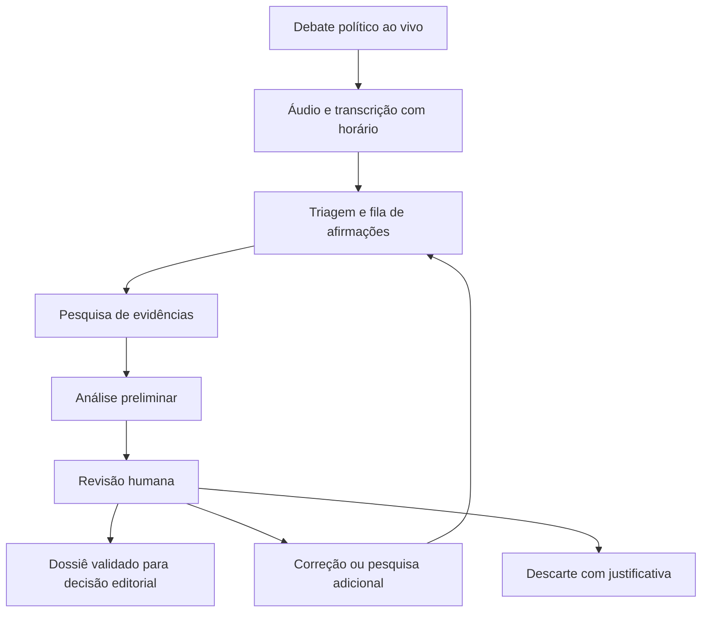

# Proposta inicial do sistema de checagem assistida por IA em debates políticos ao vivo

**Versão 0.1 · 22 de outubro de 2026 · Proposta para discussão**

O projeto pretende apoiar uma equipe de checagem durante debates políticos ao vivo. O sistema acompanhará as falas, identificará afirmações verificáveis e preparará dossiês com evidências, contexto e uma conclusão preliminar. A equipe humana validará as informações e decidirá sobre qualquer divulgação.

O primeiro piloto será um debate político ao vivo, conforme a escolha do proponente. A hipótese a testar é que a assistência de IA reduz o tempo de pesquisa e organização das evidências, preservando a qualidade da revisão editorial.

O andamento técnico está no [checklist de desenvolvimento](checklist-desenvolvimento.md). As versões 0.12 e 0.13 acrescentam recuperação local e relatório operacional; a 0.14 inclui planejamento dos dossiês e a 0.15 permite revisar e reclassificar extrações com histórico e invalidação de resultados dependentes. A 0.16 acrescenta filtros locais da fila e dois diagramas SVG: [fluxo interno](diagramas/fluxo-interno.svg) e [jornada do usuário](diagramas/fluxo-usuario.svg), distinguindo funções disponíveis e planejadas. A 0.17 integra descoberta de URLs pela Tavily, opcional e solicitada pelo operador, com chave em memória, histórico e candidatas separadas das evidências. Seleção e coleta dos documentos continuam humanas; a chamada real ao novo provedor ainda precisa de validação. O [guia de operação e recuperação](operacao-e-recuperacao.md) documenta os ensaios técnicos e o roteiro para conferência humana. A avaliação editorial e o piloto ao vivo continuam pendentes.

## Problema e proposta de valor

Durante um debate, várias afirmações podem exigir pesquisa ao mesmo tempo. A equipe precisa localizar a fala exata, interpretar o contexto, encontrar fontes adequadas e avaliar se os dados respondem à declaração.

A proposta é reunir essas etapas em um ambiente de trabalho: transcrição com marcação de tempo, fila de afirmações, pesquisa assistida e painel de revisão. Cada conclusão deverá apontar para evidências consultáveis. A economia de tempo e a qualidade serão avaliadas no piloto.

A Full Fact já descreve ferramentas de transcrição ao vivo, identificação de afirmações e correspondência com checagens anteriores. Esse precedente ajuda a orientar o projeto; o desempenho em português e no fluxo aqui proposto será avaliado separadamente. [Full Fact AI](https://fullfact.ai/product/)

## Premissas e escolhas abertas

| Tema | Situação |
| --- | --- |
| Primeiro caso de uso | Debate político ao vivo, escolhido pelo proponente. |
| Papel da IA | Pesquisa e análise preliminar, com decisão final humana. |
| Divulgação | Qualquer divulgação depende de validação humana; o piloto funcionará internamente. |
| Idioma e contexto | Português do Brasil como premissa inicial, a confirmar para o evento selecionado. |
| Cobertura temática | Afirmações factuais dos temas presentes no debate; a capacidade de checagem dependerá das fontes disponíveis. |
| Participantes e transmissão | Evento, participantes, origem do áudio e condições de acesso a definir. |
| Tecnologias e orçamento | Fornecedores, modelos, infraestrutura, custos e prazos a definir após o desenho do piloto. |

O foco em debates permanece central. Entrevistas e outras transmissões são possibilidades de expansão após a avaliação do primeiro piloto.

## Usuários e responsabilidades

| Papel | Responsabilidade |
| --- | --- |
| Operador do evento | Configurar a entrada de áudio, acompanhar a transcrição, corrigir atribuições de fala e observar falhas. |
| Revisor de checagem | Conferir a afirmação, examinar as fontes, complementar a pesquisa e registrar sua decisão. |
| Editor responsável | Definir critérios editoriais, resolver casos controversos e decidir sobre eventual divulgação. |
| Equipe técnica | Manter o processamento, os controles de acesso, a rastreabilidade e as medições. |

Uma pessoa poderá acumular funções no piloto, desde que a responsabilidade por cada decisão fique registrada. Casos sensíveis ou com divergência relevante deverão ser encaminhados ao editor.

## Escopo do primeiro piloto

### Funcionalidades previstas

- Acompanhar uma única transmissão de debate ao vivo e permitir ensaio com gravação.
- Transcrever em português, com horário e atribuição de participante corrigível.
- Identificar e separar afirmações factuais, preservando a fala original.
- Priorizar afirmações por relevância pública, especificidade e possibilidade de checagem.
- Pesquisar fontes na web e em uma coleção editorial preparada para o evento.
- Localizar checagens anteriores, verificando se contexto, período e abrangência continuam equivalentes.
- Montar dossiês com evidências favoráveis e contrárias, lacunas e análise preliminar.
- Oferecer fila de revisão, atribuição de responsável, histórico e exportação interna.
- Registrar tempos, falhas, custo de processamento e alterações humanas.

### Limites da primeira versão

A primeira versão terá publicação sob controle editorial e sem envio automático para redes sociais ou para a transmissão. Não incluirá análise de intenção de mentir, nota geral de confiabilidade dos candidatos, previsão de resultados eleitorais ou verificação de imagens e vídeos manipulados.

Opiniões, preferências e promessas futuras serão identificadas como não verificáveis naquele formato. Eventuais premissas factuais contidas nessas falas poderão gerar afirmações separadas para pesquisa.

## Fluxo de trabalho durante o debate

1. O operador inicia a sessão e verifica a qualidade do áudio e a sincronização dos horários.
2. A transcrição recebe versões provisórias até estabilizar o trecho. Dúvidas sobre números, nomes ou participante ficam sinalizadas.
3. A triagem identifica afirmações verificáveis, divide frases compostas e agrupa repetições equivalentes.
4. O sistema coloca as afirmações na fila e permite ajuste de prioridade pela equipe.
5. A pesquisa procura evidências que sustentem, contradigam ou contextualizem a afirmação.
6. A análise relaciona cada conclusão ao material recuperado e explicita lacunas.
7. O revisor confere a fala e as fontes, corrige, solicita nova pesquisa, descarta ou conclui a revisão.
8. O editor decide sobre eventual divulgação por um processo externo ao piloto.

Se a fala ou a evidência usada for corrigida, o dossiê receberá nova versão e exigirá revalidação. Uma aprovação anterior ficará preservada no histórico, vinculada à versão que foi efetivamente revisada.

## Funções dos agentes de IA

A arquitetura proposta usa funções delimitadas, coordenadas por um fluxo de processamento com permissões explícitas. A quantidade de agentes e modelos poderá ser ajustada após o ensaio.

| Função | Entrada e saída esperadas |
| --- | --- |
| Identificação de afirmações | Recebe transcrição e contexto; propõe afirmações individuais, temas, participantes e recortes a verificar. |
| Pesquisa | Recebe a afirmação; recupera documentos e trechos com origem, data e relação com a pergunta. |
| Análise de evidências | Confronta afirmação e documentos; prepara síntese, classificação preliminar e explicação das lacunas. |
| Revisão de consistência | Confere correspondência das citações, períodos, unidades e conclusões; aponta falhas para o revisor humano. |

A pesquisa deve procurar elementos favoráveis e contrários sem assumir antecipadamente um veredito. A revisão de consistência terá o papel de detectar erros específicos; concordância entre agentes será avaliada pela qualidade e independência das evidências.

Os agentes não terão permissão para aprovar editorialmente um dossiê, alterar uma decisão humana ou publicar conteúdo. Esses limites serão aplicados pelo sistema de autorização.

## Metodologia de checagem

A metodologia editorial terá como referências a transparência de fontes, os critérios consistentes de seleção e a possibilidade de correção descritos pela IFCN. A metodologia brasileira do Aos Fatos também oferece referência para contextualização e consulta a fontes oficiais e alternativas. [IFCN](https://ifcncodeofprinciples.poynter.org/the-commitments), [Aos Fatos](https://www.aosfatos.org/webstories/como-o-aos-fatos-faz-uma-checagem/)

### Definição da afirmação

Registrar a fala literal e formular uma pergunta de checagem sem mudar seu significado. Identificar entidade, local, período, indicador e comparação. Quando houver ambiguidade relevante, solicitar esclarecimento ao revisor antes de concluir.

A seleção seguirá os mesmos critérios para todos os participantes. A auditoria avaliará afirmações elegíveis, selecionadas e descartadas por participante e tema; a quantidade de checagens será interpretada à luz do conteúdo das falas.

### Seleção e leitura das fontes

Priorizar documentos primários adequados à pergunta: bases estatísticas, documentos originais, relatórios com metodologia e estudos pertinentes. A origem oficial será considerada junto com sua finalidade, seus limites e possíveis interesses.

Cada evidência deverá incluir URL, instituição ou autor, trecho ou localização, data de publicação quando disponível, período dos dados e momento da consulta. Em tabelas, registrar unidade, filtros e cálculo utilizado. Em PDFs, registrar página; em documentos longos, seção ou outro localizador.

Usar mais de uma origem independente quando pertinente. Documentos que reproduzem a mesma pesquisa deverão ser ligados à origem comum. Quando houver apenas uma fonte relevante, essa condição deverá ficar explícita.

Um link servirá como evidência somente após a recuperação e leitura do conteúdo pertinente. Resultados de busca e títulos ajudam a localizar documentos, mas não bastam para sustentar o veredito.

### Contexto e validade temporal

Conferir se os dados respondem ao período, território e população citados. Verificar diferenças como valores absolutos e proporcionais, valores nominais e corrigidos ou percentuais e pontos percentuais.

A pesquisa deverá distinguir a informação disponível no momento da fala de revisões posteriores. Nos ensaios com gravação, o corte temporal será registrado para evitar usar dados futuros como se estivessem disponíveis durante o debate.

Checagens anteriores poderão acelerar a pesquisa após conferência de equivalência e atualidade. Lacunas, conflitos entre fontes e acesso bloqueado deverão aparecer no dossiê.

## Classificações e estados do trabalho

### Classificação preliminar

| Classificação | Critério proposto |
| --- | --- |
| Confirmada | As evidências sustentam os elementos materiais da afirmação no recorte verificado. |
| Contradita | As evidências contrariam um elemento material da afirmação. |
| Precisa de contexto | Há omissão, comparação inadequada ou combinação de elementos que exige explicação para evitar interpretação enganosa. |
| Inconclusiva | A evidência disponível é insuficiente, conflitante ou inadequada para uma conclusão. |

A categoria “não verificável” pertence à triagem de opiniões, previsões ou enunciados sem definição suficiente. O descarte deverá indicar o motivo e poderá ser revisto por uma pessoa.

Na primeira versão, a análise apresentará a suficiência das evidências e as dúvidas em linguagem direta. Uma porcentagem de confiança exigiria calibração própria antes de ser oferecida como estimativa confiável.

### Estados independentes

| Dimensão | Estados propostos |
| --- | --- |
| Processamento | Detectada, na fila, em pesquisa, análise pronta, erro ou cancelada. |
| Revisão | Pendente, em revisão, pesquisa adicional, concluída, descartada ou revalidação necessária. |
| Conclusão | Classificação preliminar da IA e classificação final humana, armazenadas separadamente. |

Pesquisa interrompida, prazo excedido e falha de acesso terão registro operacional próprio. A conclusão poderá permanecer inconclusiva, sem transformar a falha em evidência contra a fala.

“Revisão concluída” significa que uma pessoa validou o dossiê. A divulgação continuará dependendo da decisão editorial.

## Conteúdo mínimo de um dossiê

| Grupo | Campos necessários |
| --- | --- |
| Identificação | Evento, participante, tema, identificador da afirmação e responsável pela revisão. |
| Fala | Texto literal, versão da transcrição, início e fim do trecho, acesso ao áudio e contexto próximo. |
| Pergunta de checagem | Resumo fiel, afirmações individuais, recortes, ambiguidades e prioridade justificada. |
| Evidências | Documentos consultados, trechos ou tabelas, localização, autoria, datas, independência e relação com a afirmação. |
| Análise | Síntese, cálculos reproduzíveis, evidências favoráveis e contrárias, lacunas e classificação preliminar. |
| Revisão | Decisão humana, justificativa, alterações, autor, horário e versão revisada. |
| Operação | Consultas realizadas, versões de modelos e instruções, tempos, falhas e uso dos serviços. |

### Exemplo ilustrativo

**Fala hipotética:** “Reduzimos o desemprego pela metade durante nosso mandato.”

**Pergunta de checagem:** a taxa de desemprego, no território e nos marcos temporais atribuídos ao mandato, caiu 50% em termos relativos?

**Pontos a esclarecer:** território, datas de comparação, indicador utilizado e consistência metodológica da série. A atribuição causal ao governo precisará de análise própria e não será demonstrada apenas pela mudança do indicador.

**Pesquisa prevista:** consultar a série e a metodologia correspondentes; comparar os valores pelo cálculo (taxa inicial − taxa final) ÷ taxa inicial × 100.

**Conclusão preliminar do exemplo:** inconclusiva até recuperar os dados e definir os recortes. Nenhuma evidência foi atribuída a essa fala hipotética.

## Requisitos de aceitação da primeira versão

| Requisito | Como verificar |
| --- | --- |
| Fala rastreável | Cada afirmação aponta para trecho da mídia e versão da transcrição. |
| Atribuição corrigível | Uma pessoa consegue corrigir o participante sem perder o histórico. |
| Revisão de transcrição | Mudanças materiais invalidam a análise dependente e exigem revalidação. |
| Evidência consultável | Cada conclusão material aponta para documento recuperado e localização, ou apresenta a lacuna. |
| Controle humano | Tentativas de aprovação por agentes e usuários sem permissão são recusadas. |
| Histórico de revisão | Correções preservam versões anteriores, autor e justificativa. |
| Falhas visíveis | Ausência de fonte, interrupção de áudio e atraso na fila aparecem para o operador. |
| Pesquisa controlada | A equipe consegue limitar concorrência, tempo e custo e solicitar nova pesquisa. |
| Repetições contextualizadas | O reaproveitamento confere período, território, indicador e validade da checagem. |
| Exportação identificada | O material exportado informa sua versão e se a revisão está pendente ou concluída. |

O painel deverá permitir revisar a fala e as evidências com facilidade antes de aceitar a sugestão da IA. Resumos sem acesso aos documentos não satisfazem o requisito de evidência consultável.

## Arquitetura proposta

A aplicação terá um painel para a equipe e um serviço de coordenação que mantém o estado de cada afirmação. O processamento de áudio, as pesquisas e as análises serão executados em tarefas assíncronas para permitir acompanhar várias afirmações e lidar com atrasos.

| Componente | Responsabilidade |
| --- | --- |
| Entrada de mídia e transcrição | Receber áudio, manter marcações de tempo e versões do texto e sinalizar incertezas. |
| Coordenador e fila de tarefas | Controlar prioridades, versões, limites de execução, repetição de tarefas e cancelamento. |
| Pesquisa e leitura de fontes | Consultar a coleção preparada e a web, recuperar documentos e registrar proveniência. |
| Análise e consistência | Produzir o dossiê e verificar sua ligação com as evidências. |
| Banco de registros | Guardar eventos, falas, afirmações, estados e revisões humanas. |
| Armazenamento de mídia e evidências | Preservar trechos e cópias permitidas, com localização e identificação de versão. |
| Painel e controle de acesso | Mostrar filas, fontes e histórico e aplicar as permissões de cada papel. |
| Monitoramento | Medir tempos, custos, erros e volume de trabalho. |

A coordenação deverá impedir que tarefas antigas sobrescrevam resultados produzidos a partir de versões mais recentes da fala. Novas tentativas terão identificação própria para evitar dossiês duplicados.

Os conectores de transcrição, modelos e busca serão substituíveis. A seleção das tecnologias virá após uma comparação com áudio em português e condições representativas do debate.

## Plano de execução do piloto

| Etapa | Entrega | Condição de avanço |
| --- | --- | --- |
| Preparação editorial e operacional | Debate selecionado, equipe, transmissão acessível, critérios e coleção de fontes. | Responsáveis, acesso à mídia e capacidade de revisão definidos. |
| Referência humana e ensaio | Gravação reproduzida como transmissão e conjunto de afirmações anotadas. | Medições iniciais e falhas críticas identificadas. |
| Protótipo integrado | Entrada de áudio, triagem, pesquisa, dossiês e painel funcionando em conjunto. | Controle humano, rastreabilidade e tratamento de falhas demonstrados. |
| Piloto durante debate ao vivo | Uso interno pela equipe, com registro de decisões e desempenho. | Operador e revisores disponíveis e interrupção manual possível. |
| Avaliação | Comparação com trabalho manual e relatório de qualidade, tempo e custo. | Decisão fundamentada sobre correções, novo piloto e expansão. |

O ensaio com gravação prepara a operação. O objetivo do primeiro piloto continua sendo o acompanhamento de um debate político ao vivo. Datas e duração dependerão do evento escolhido e da capacidade da equipe.

## Como avaliar o resultado

A referência de avaliação será construída por revisores humanos. A comparação entre trabalho manual e assistido deverá usar conjuntos equivalentes e distribuir a ordem de trabalho para reduzir o efeito de já conhecer as respostas. Divergências entre revisores serão registradas e resolvidas editorialmente.

| Indicador | Definição |
| --- | --- |
| Precisão da triagem | Afirmações realmente verificáveis entre as selecionadas pelo sistema. |
| Cobertura da triagem | Afirmações verificáveis selecionadas entre as anotadas pela equipe no material avaliado. |
| Correção das evidências | Relações entre conclusão e fonte julgadas corretas entre as relações examinadas pelos revisores. |
| Correções de análise | Dossiês com alteração material de interpretação ou classificação entre os revisados. |
| Tempo de detecção | Da chegada da fala à entrada da afirmação estabilizada na fila. |
| Tempo de pesquisa | Da entrada na fila à primeira versão de dossiê com evidência utilizável. |
| Tempo até decisão | Da chegada da fala à conclusão da revisão humana, incluindo espera na fila. |
| Trabalho humano | Tempo ativo de revisão e pesquisa complementar por afirmação. |
| Operação e custo | Falhas, atrasos, tentativas, buscas e uso dos serviços por hora de evento e por dossiê revisado. |

Os tempos serão apresentados por mediana e percentil 95 quando houver amostra suficiente. Itens sem dossiê ou sem decisão permanecerão visíveis no denominador de cobertura, com motivo e tempo de espera. Resultados serão separados por tema e complexidade.

Antes do piloto ao vivo, a equipe deverá fixar os limites aceitáveis de erro, latência e custo a partir do ensaio. O objetivo é demonstrar redução de trabalho humano com qualidade compatível com os critérios editoriais.

Qualquer fonte inventada ou aprovação indevida será tratada como falha crítica. O caso afetado exigirá correção e revisão do controle antes de poder ser aprovado. Uma classificação inconclusiva bem fundamentada será avaliada pela adequação ao material disponível.

## Riscos e controles propostos

| Risco | Controle previsto |
| --- | --- |
| Número, negação ou participante transcrito incorretamente | Sinalizar dúvida, disponibilizar áudio e revalidar análises após correção. |
| Fonte inadequada ou conclusão sem respaldo | Exigir documento recuperado, trecho pertinente e conferência humana. |
| Perda de contexto | Preservar falas próximas e conferir recortes, indicadores e comparações. |
| Viés na seleção | Aplicar critérios consistentes e registrar cobertura e descartes por participante e tema. |
| Aceitação apressada da sugestão da IA | Facilitar a leitura da evidência, registrar justificativas e avaliar casos com revisão sem acesso prévio ao veredito sugerido. |
| Excesso de afirmações ou falha de serviço | Priorizar a fila, agrupar repetições, limitar tarefas e manter pendências visíveis. |
| Instruções maliciosas em páginas consultadas | Tratar documentos externos como dados e restringir as ferramentas e permissões dos agentes. |
| Acesso indevido e retenção excessiva | Usar autenticação, permissões por papel e regras de armazenamento e retenção definidas antes da operação. |

A equipe definirá as condições de uso e armazenamento da transmissão e dos documentos. Credenciais de serviços ficarão fora dos dossiês e dos registros exportáveis.

## Próximas decisões e backlog inicial

### Decisões para preparar o piloto

1. Selecionar o debate, a data e a origem da transmissão.
2. Definir quem opera, revisa e responde pela decisão editorial.
3. Confirmar idioma, participantes e capacidade de atendimento da equipe.
4. Definir critérios de prioridade, classificação e encaminhamento de casos controversos.
5. Escolher os serviços candidatos e o orçamento máximo do experimento.
6. Preparar fontes por tema, critérios de atualização e regras de armazenamento.
7. Fixar limites de qualidade, latência e custo antes da operação ao vivo.

### Primeiras entregas de desenvolvimento

- Cadastro de evento e participantes, com entrada de áudio de teste.
- Transcrição com marcação de tempo e correção humana.
- Fila de afirmações com prioridade e agrupamento de repetições.
- Pesquisa com recuperação de documentos e registro de trechos.
- Geração do dossiê e conferência da correspondência com as fontes.
- Painel de revisão com permissões, histórico e revalidação.
- Medição e relatório do ensaio.
- Preparação operacional e execução do piloto ao vivo.

Cada entrega deverá ser revisável em um ensaio antes da integração ao fluxo do evento.

## Referências e fontes candidatas

### Referências de produto e metodologia

- [Full Fact AI](https://fullfact.ai/product/): referência de acompanhamento ao vivo, identificação de afirmações e reutilização de checagens.
- [Código de princípios da IFCN](https://ifcncodeofprinciples.poynter.org/the-commitments): referência para imparcialidade, fontes, metodologia e correções.
- [Como o Aos Fatos faz uma checagem](https://www.aosfatos.org/webstories/como-o-aos-fatos-faz-uma-checagem/): referência brasileira de seleção, pesquisa e contextualização.

### Fontes candidatas para preparar o evento

A coleção será organizada conforme os temas previstos e a pertinência de cada documento. Para dados estatísticos e séries econômicas, os catálogos do [IBGE](https://www.ibge.gov.br/) e do [Banco Central](https://www3.bcb.gov.br/sgspub/) são pontos de partida. Para outras afirmações, serão necessários documentos e especialistas correspondentes ao tema.

A entrada de uma instituição na coleção não valida automaticamente suas publicações nem garante integração técnica. Cada evidência será examinada em relação à afirmação concreta.
